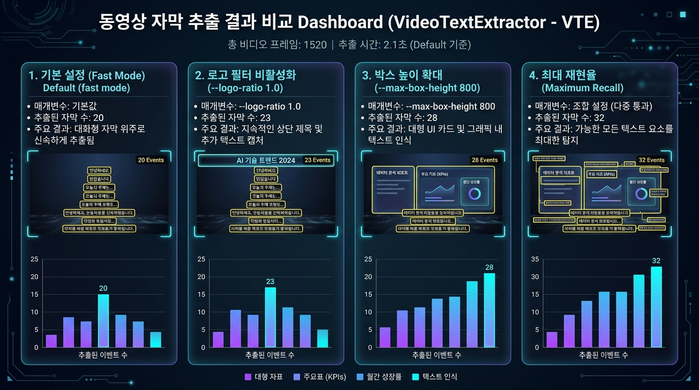

# VideoTextExtractor (VTE)

영상 속 화면 텍스트(자막·타이틀·삽입글)를 자동으로 찾아 **시간 구간**과 **텍스트**로
추출하는 CLI 도구입니다. 한국어 인식이 기준이며, 하드코딩된 자막(burned-in
subtitle)이 있는 영상에서 SRT/TXT/JSON/ASS 파일을 생성합니다.

## 주요 기능

| 기능 | 설명 |
|---|---|
| 타임 구간 검출 | 글자가 보이는 구간을 `[start, end]` 리스트로 출력 |
| 한국어 OCR | PaddleOCR `korean_PP-OCRv5_mobile_rec` 기반 (엔진 교체 가능) |
| 위치 자동 추적 | 프레임 간 텍스트 bbox를 IoU 매칭으로 추적 — ROI 수동 지정 불필요 |
| 중복 제거 | 유사도 병합(≥85%) + debounce(gap ≤0.5s) + 최소지속 필터(≥0.5s) |
| 로고·워터마크 필터 | 영상의 80% 이상 존재하는 정적 텍스트를 로고로 분류 |
| 장면전환 스킵 | 정적 구간 재검출 생략으로 처리 속도 향상 |
| 실행 모드 | `fast` / `auto` / `precise` 3단계 (속도↔정확도) |
| 이미지 전처리 | CLAHE 명암보정, 저해상도 업스케일 |
| 웹 UI | `vte ui` — 화면 진행과 추출 텍스트를 한 화면에서 실시간 확인 |

## 설치

Python 3.10+ 필요 (macOS/Linux 개발 기준, CPU 우선).

```bash
git clone <this-repo> && cd oxalpha

# 가상환경
python3 -m venv .venv && source .venv/bin/activate

# 코어 설치 (OCR 엔진 제외 — 테스트와 비OCR 기능만 사용)
pip install -e .

# OCR 엔진 포함 전체 설치 (권장, 용량 큼)
pip install -r requirements.txt
# 또는: pip install -e ".[ocr]"
```

## 사용 방법 (Usage)

### 1. 기본 실행 스크립트 (`run.sh`)

프로젝트 루트에 제공되는 `run.sh` 스크립트를 사용하여 기본 설정으로 즉시 자막 추출을 수행할 수 있습니다.

```bash
# 기본 실행 (claude_first60s.mp4, fast 모드, json 포맷, out.json 저장)
./run.sh

# 영상 파일, 모드, 포맷, 출력 파일 지정
./run.sh input_video.mp4 fast json output.json

# 추가 커스텀 인자 전달
./run.sh claude_first60s.mp4 fast srt output.srt --logo-ratio 1.0 --max-box-height 800
```

### 2. CLI 직접 실행 (`vte`)

```bash
# 자막 및 시간 구간 추출 (SRT 포맷)
vte extract 동영상.mp4 --mode fast --format srt --output 자막.srt

# 자막 존재하는 시간 구간만 텍스트로 출력
vte intervals 동영상.mp4 --mode fast

# 고급 파라미터 조정을 적용한 추출
vte extract 동영상.mp4 --mode fast --logo-ratio 1.0 --max-box-height 800 --format json --output result.json
```

### 3. 웹 UI (`vte ui`)

브라우저에서 추출을 돌리고 결과를 바로 확인한다. **추가 의존성이 없다**
(웹 프레임워크 없이 Python 표준 라이브러리만 사용).

```bash
vte ui                       # 기본 http://127.0.0.1:8765 (실행 시 브라우저 자동 오픈)
vte ui --port 9000           # 포트 지정
vte ui --host 0.0.0.0        # 외부 접속 허용
vte ui --no-browser          # 브라우저를 열지 않음
```

화면 구성은 **상단 화면 진행 / 하단 추출된 텍스트** 두 영역이며, 우측
사이드바에서 입력과 내보내기를 다룬다.

| 영역 | 내용 |
|---|---|
| 상단 — 화면 진행 | 영상 재생, 진행 바, 현재 프레임의 검출 박스 오버레이 |
| 하단 — 추출된 텍스트 | 확정된 구간별 텍스트 (시간·신뢰도·미리보기 점프) |
| 우측 — 제어 | 영상 경로, 모드(`fast`/`auto`/`precise`), 고급 파라미터 |
| 우측 — 내보내기 | SRT / TXT / JSON / ASS 저장 |

패널과 API 라우트는 레지스트리 방식이라 기능을 한 줄씩 덧붙일 수 있다.
자세한 구조와 확장 방법은 `docs/TECH_NOTES.md`의 "Web UI" 절과
`docs/DECISIONS.md`의 D6을 참고.

---

## 파라미터 상세 설명 (Parameter Reference)

VTE는 다양한 영상 환경(자막 형태, 로고 위치, 해상도, 프레임 속도)에 맞게 파라미터를 세밀하게 조정할 수 있습니다.

| 인자 (CLI Flag) | 기본값 | 설명 |
|---|---|---|
| `--mode` | `auto` | 프리셋 모드 선택 (`fast`: 2fps·경량 det, `auto`: 3fps, `precise`: 6fps·고정밀) |
| `--sample-fps` | `3.0` | 초당 프레임 샘플링 비율. 자막 전환 속도가 빠른 영상은 높게 설정 |
| `--logo-ratio` | `0.8` | **로고/워터마크 필터 임계값**. 영상 전체 길이의 `N`배 이상 지속되는 정적 텍스트를 제거. (전체 상단 제목 포함 시 `1.0` 설정) |
| `--max-box-height` | `200` | **검출 박스 최대 높이 (px)**. 카드형 UI, 초대형 안내 텍스트까지 추출하려면 `800` 이상으로 확대 |
| `--min-box-height` | `8` | 검출 박스 최소 높이 (px). 화면 노이즈 문자를 제거 |
| `--det-max-side` | `1280` | 검출 입력의 **긴 변** 상한 (px). 초과 시 비율 유지 축소. 가로·세로 영상 모두에 적용. `fast` 모드는 `960` 사용으로 처리 속도 향상 |
| `--roi-band` | `None` | 검출 대상 y축 구간 지정 (예: `--roi-band 0.6,1.0` -> 하단 40% 자막 밴드만 집중 검출) |
| `--line-target-height` | `48` | OCR 인식 전 라인 정규화 높이 (px). 와이드 자막의 높이 찌그러짐을 방지 |
| `--max-side` | `2000` | OCR 크롭 최장 변 상한 (px). PaddleOCR `max_side_limit 4000` 경고 방지 |
| `--min-rec-height` | `48` | 소형 텍스트 크롭 최저 높이 보장 (px). 자막 획 유실 방지 |
| `--max-rec-height` | `256` | OCR 입력 최대 높이 (px). Tall text 어순 붕괴 방지 |
| `--crop-change-threshold` | `0.003` | 동일 트랙 내 픽셀 변화 감지 썸네일 MAD 임계값 |
| `--scene-threshold` | `0.12` | 정적 프레임 판단 임계값. 값이 높을수록 정적 프레임 스킵 증가 |
| `--iou-threshold` | `0.5` | 프레임 간 바운딩 박스 추적 IoU 임계값 |
| `--sim-threshold` | `85.0` | 연속 자막 병합 및 동일 위치 자막 교체 판정 rapidfuzz 유사도 (%) |
| `--debounce-gap` | `0.5` | 동일 자막 간 자막 깜빡임(Gap) 메우기 허용 시간 (초) |
| `--min-duration` | `0.5` | 최소 자막 노출 유지 시간 (초). 이하의 플래시 노이즈는 폐기 |
| `--vote-frames` | `3` | 텍스트 확정을 위한 다수결 투표 프레임 수 |
| `--det-model` | server_det | PaddleOCR 텍스트 영역 검출 모델 |
| `--rec-model` | korean_rec | PaddleOCR 한국어 텍스트 인식 모델 |

---

## 파라미터 조율에 따른 텍스트 추출량 비교 (Extraction Comparison Dashboard)

각 파라미터를 조정함에 따라 탐지 및 추출되는 자막 이벤트의 범위와 양이 어떻게 달라지는지 비교한 결과입니다.



### 설정별 추출 결과 및 효과 비교

| 설정 조합 | 주요 변경 인자 | 추출 이벤트 수 | 추출 특징 및 효과 |
|---|---|:---:|---|
| **1. 기본 설정 (Default)** | `--mode fast` (기본값) | **20개** | 대화형 하단 자막 위주로 빠르게 추출하며, 정적 제목/워터마크는 자동 제거 |
| **2. 로고 필터 비활성화** | `--logo-ratio 1.0` | **23개** (+3) | 영상 0초부터 끝까지 상단에 고정 표시되는 제목 및 채널 로고 문구까지 모두 캡처 |
| **3. 박스 높이 확대** | `--max-box-height 800` | **28개** (+8) | 높이가 200px을 초과하는 대형 UI 카드, 그래픽 안내 상자 내 텍스트까지 탐지 |
| **4. 최대 재현율 (Max Recall)** | `--logo-ratio 1.0 --max-box-height 800` | **32개** (+12) | 고정 로고, 대형 UI, 일반 자막을 포함하여 화면 내 거의 모든 텍스트 요소를 수집 |

---

### JSON 출력 예시

```json
[
  {
    "start": 12.333,
    "end": 15.0,
    "text": "안녕하세요",
    "confidence": 0.9998,
    "bboxes": [120.0, 640.0, 800.0, 640.0, 800.0, 700.0, 120.0, 700.0]
  }
]
```

## 배포

### 개발용 설치 (editable)

```bash
pip install -e ".[dev]"   # pytest 등 개발 도구 포함
pytest tests/ -v          # 48개 단위 테스트 (OCR 엔진 불필요)
```

### 패키지 빌드

```bash
pip install build && python -m build
# dist/vte-0.1.0-py3-none-any.whl 생성 → pip install 로 배포 가능
```

배포 시 주의:

- `requirements.txt`의 `paddlepaddle`/`paddleocr`은 플랫폼별 바이너리가
  달라서 **패키지 의존성에서 제외**하고 사용자 환경에서 별도 설치한다
  (`pip install -e ".[ocr]"`).
- GPU 사용 시 `paddlepaddle-gpu`로 교체해 설치한다 (선택).

## 프로젝트 문서

- `docs/DESIGN.md` — 아키텍처 설계
- `docs/PLAN2.md` — 마일스톤 플랜 (M0~M6)
- `docs/SOURCE.MD` — 유사 프로젝트 조사
- `AGENTS.md` — 멀티 에이전트 작업 규칙 / `docs/AI_WORKFLOW.md` — 빌드·검증 절차

## 프로젝트 구조

```
src/vte/
├── cli.py            # vte extract / intervals 진입점
├── config.py         # 설정 (모드 프리셋, 임계값)
├── models.py         # TextBox, Track, TextEvent
├── video_reader.py   # fps 샘플링
├── scene_detector.py # 장면전환 감지 · 정적 프레임 스킵
├── detector.py       # 텍스트 영역 검출 (PaddleOCR det)
├── tracker.py        # IoU 위치 추적 ★핵심
├── recognizer.py     # 한글 인식 (PP-OCRv5 rec)
├── segmenter.py      # 시간 구간 병합 · 중복 제거 ★핵심
├── filters.py        # 로고/워터마크 분류
├── preprocess.py     # 명암보정 · 업스케일 · crop
├── postprocess.py    # 텍스트 정규화
├── exporter.py       # SRT/TXT/JSON/ASS
└── pipeline.py       # end-to-end 연결
tests/                # pytest (외부 엔진 없이 실행 가능)
```

## 라이선스

미정 (프로젝트 소유자 확인 후 추가).
